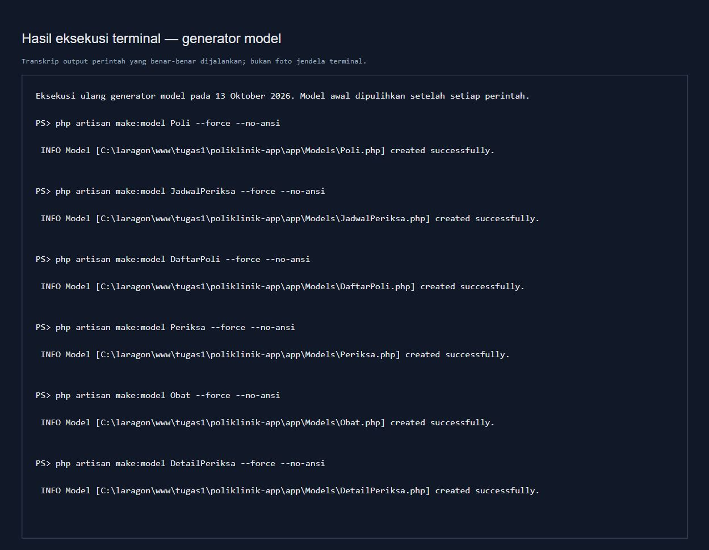
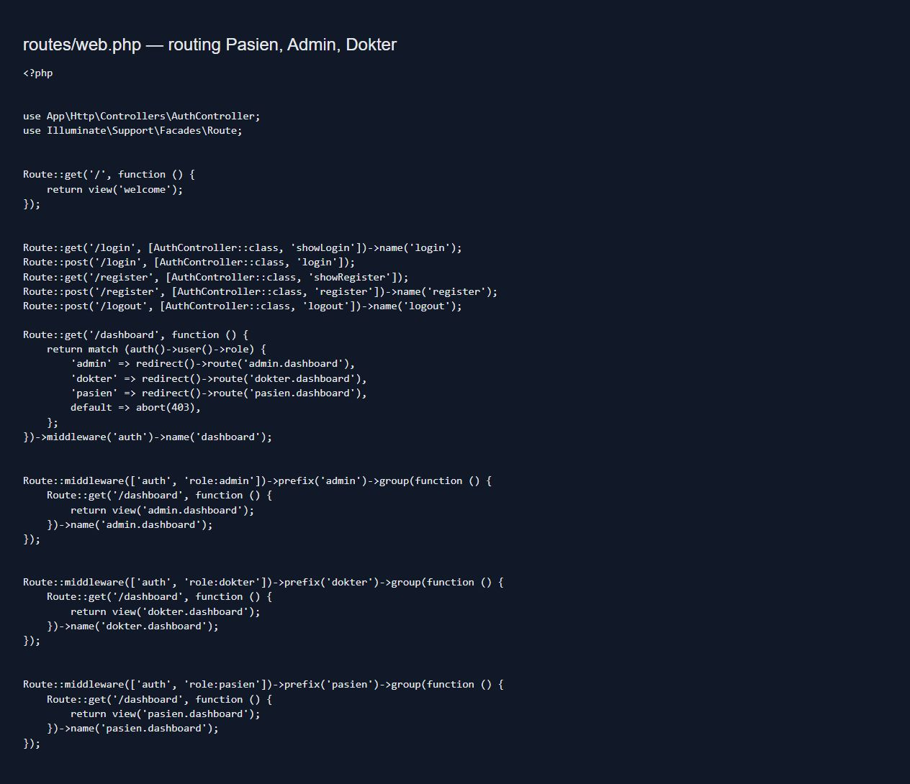
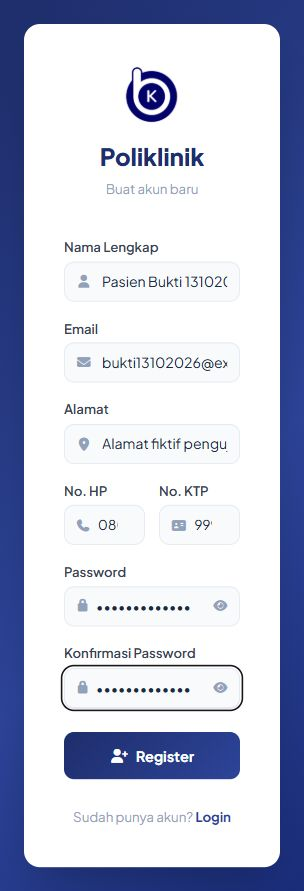
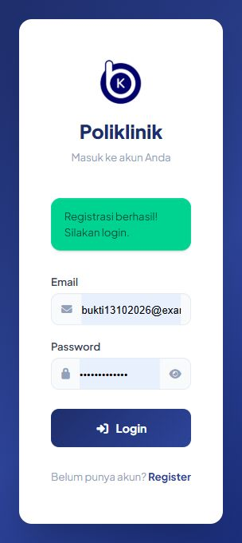
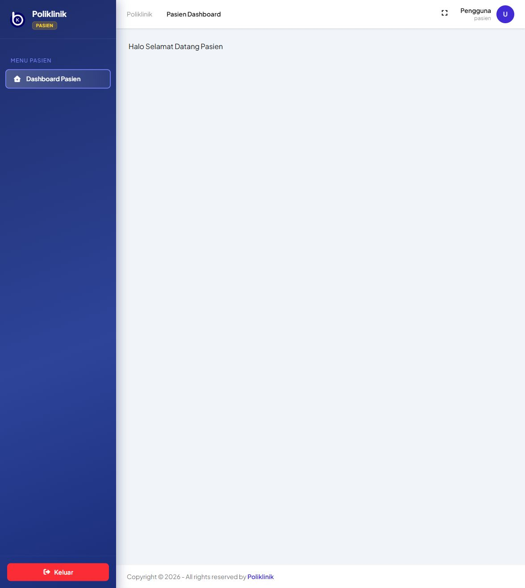
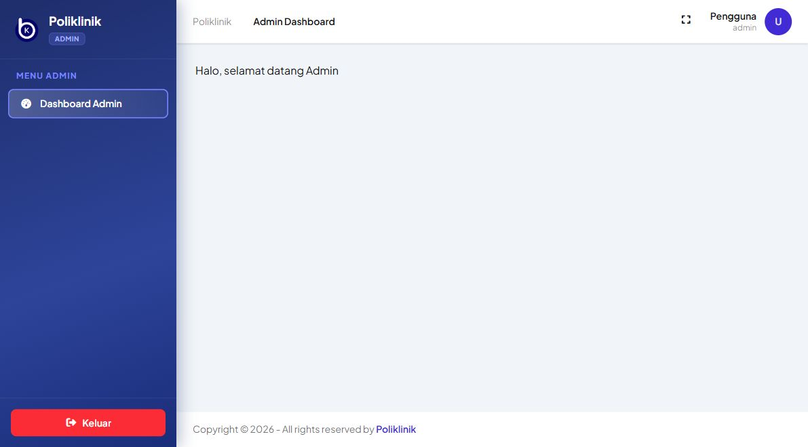
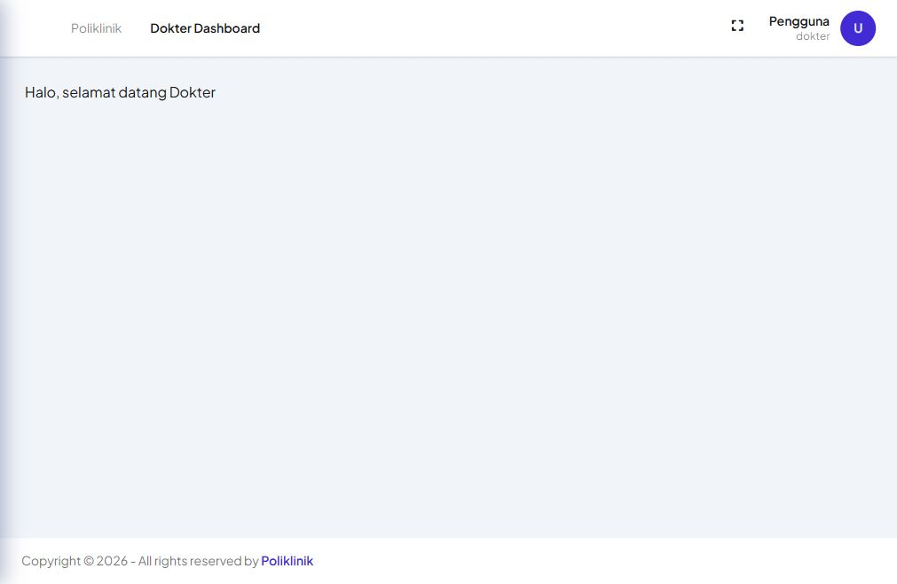
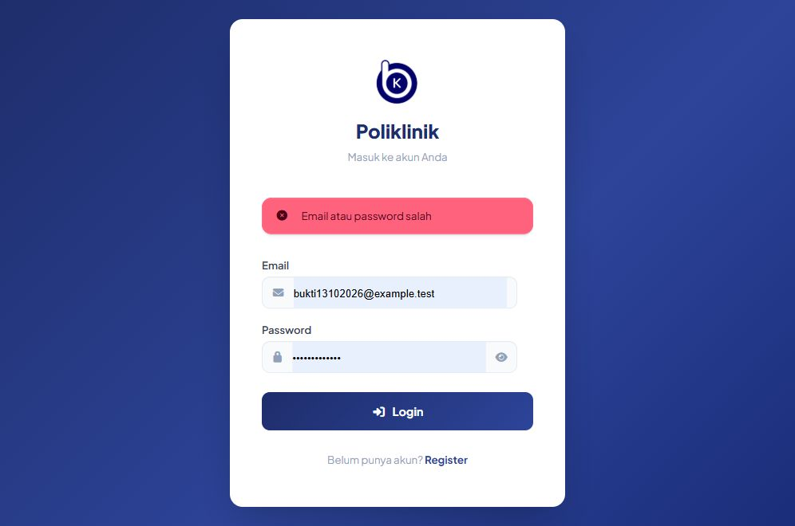

# Bukti pengerjaan Poliklinik

Dikumpulkan pada 13 Oktober 2026 menggunakan aplikasi Laravel lokal dan data pasien fiktif.

## 1. Generator model

Screenshot ini menampilkan transkrip output terminal yang benar-benar dieksekusi, bukan foto jendela terminal. Keenam model sudah tersedia sebelum pengumpulan bukti. Perintah `php artisan make:model NAMA --force --no-ansi` dijalankan ulang satu per satu, lalu isi model asli dipulihkan agar relasi dan konfigurasi tidak hilang. Output lengkap: [model-terminal.txt](model-terminal.txt).

## 2. Routing multi-user

Sumber: [routes/web.php](../../routes/web.php). Setiap dashboard menggunakan middleware `auth` dan `role`, dengan role `pasien`, `admin`, dan `dokter`. Hasil Artisan: [route-list.txt](route-list.txt).

## 3. Register dan Login

Registrasi mengarahkan ke Login dengan pesan sukses. Akun hasil registrasi berhasil digunakan untuk Login sebagai Pasien.

Pengujian otomatis: **8 tes lulus, 64 assertion**. Mencakup hash password, role Pasien saat registrasi, konfirmasi password, email/KTP duplikat, login tiga role, dashboard role lain ditolak dengan 403, redirect tamu ke Login, dan logout. Hasil: [test-results.txt](test-results.txt). Jalankan ulang dengan `php artisan test --compact`.

Perbaikan saat verifikasi: validasi konfirmasi password, validasi input Login, regenerasi sesi setelah Login, invalidasi sesi dan token CSRF setelah Logout, serta tampilan pesan sukses Register.

File `.env` dan cadangannya tidak disertakan dalam commit.
